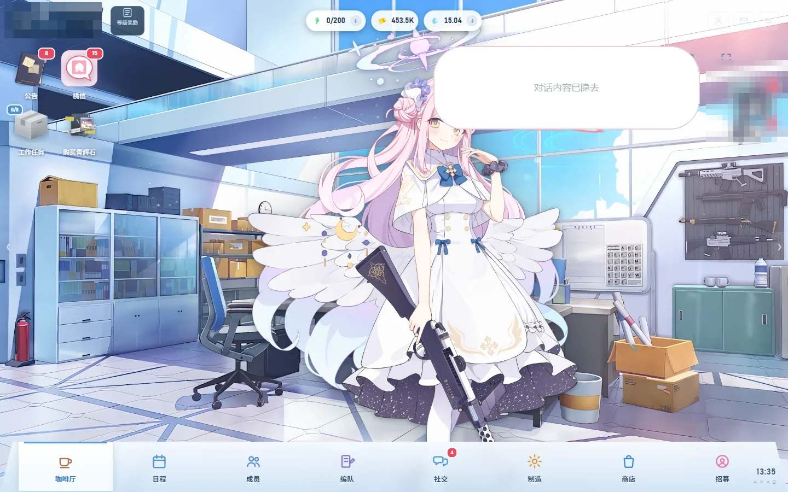
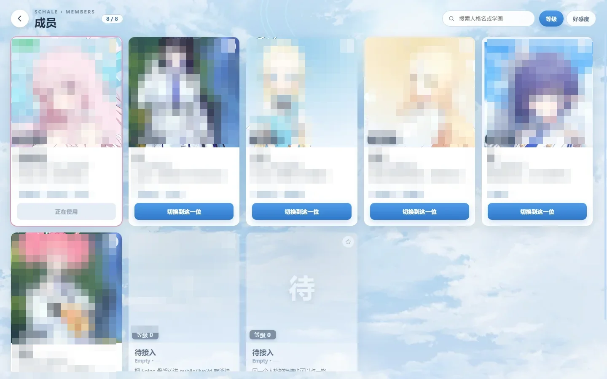
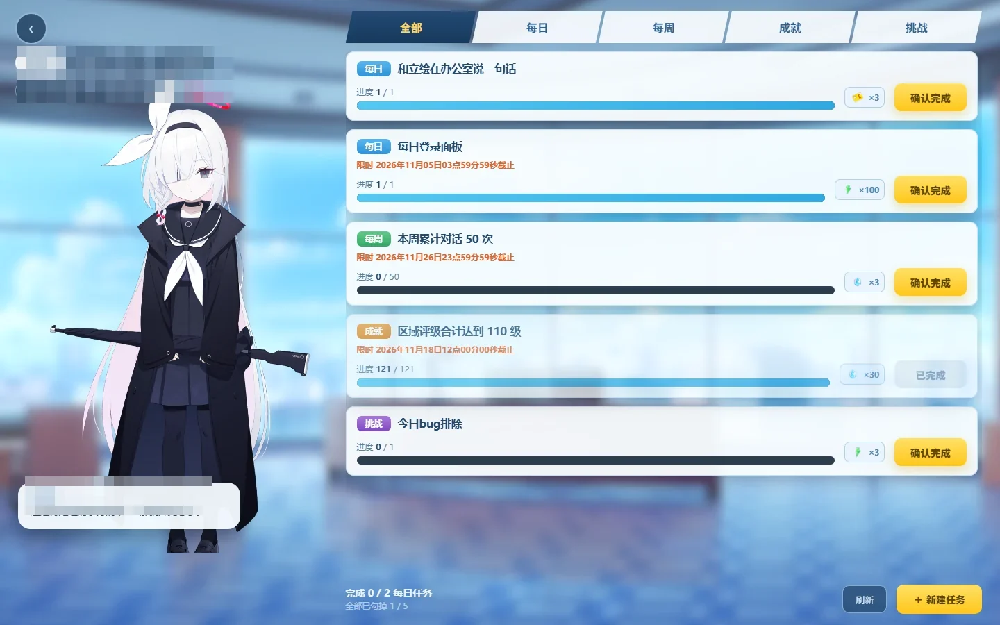
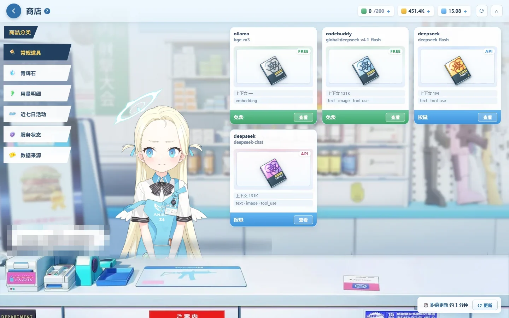
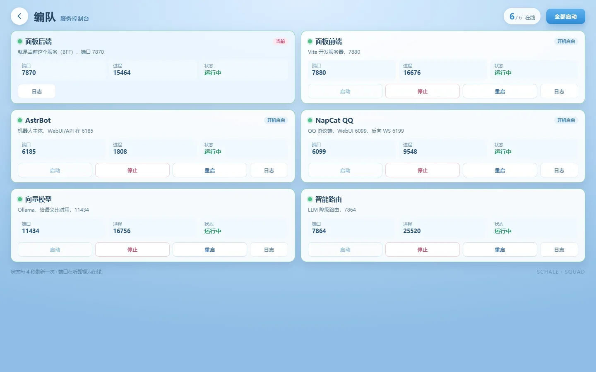

# Schale Panel · 碧蓝档案风格 AstrBot 控制面板

> 把 AstrBot 的一堆黑窗口、配置文件、日志，收进一间看得见阳光的夏莱办公室。

一个纯前端套壳 + 轻量 BFF 的**可视化控制台**：大厅里站着会呼吸的看板娘，桃信里躺着真实的 QQ 对话，编队页一屏启停所有后台服务。



---

## 目录

- [它是什么](#它是什么)
- [界面一览](#界面一览)
- [快速开始](#快速开始)
- [config.json 要改什么](#configjson-要改什么)
- [它是怎么跑的](#它是怎么跑的)
- [HTTP 接口](#http-接口)
- [前端开发](#前端开发)
- [目录结构](#目录结构)
- [常见问题](#常见问题)
- [隐私与数据](#隐私与数据)
- [素材来源与致谢](#素材来源与致谢)
- [License](#license)

---

## 它是什么

AstrBot 本身是个聊天机器人框架，实际用起来往往要开 4~6 个进程、改几个 JSON、翻日志看它是不是又崩了。这个面板做的事情是：

| 痛点 | 面板的做法 |
|---|---|
| 开一堆黑窗口 | 「编队」页一屏查看端口/进程/状态，一键启停重启 |
| 不知道 bot 在跟谁聊 | 「桃信」直接读真实 QQ 消息，按人分档、按时间分段 |
| 改配置要开记事本 | 资料页/成员页直接在界面里改，落盘到后端 |
| 界面千篇一律 | 碧蓝档案风格的完整 UI：大厅、商店、成员、日程、招募 |
| 立绘是死的 | Spine 骨骼动画，会呼吸、会眨眼、会随情绪换气泡 |

> 它**不是** AstrBot 的替代品，是一层壳：所有数据仍然来自 AstrBot 自己的目录，面板只读不写（人格卡只读，见下）。

---

## 界面一览

**大厅** —— 看板娘站班，气泡内容由 LLM 实时生成，右上角是今天的日期与心情符号。


**成员** —— 八位角色卡，点进去是人格设定卡 / 相处数据 / 内心读数三个页签。



**工作任务** —— 每日/每周/成就/挑战四类，左侧看板娘可切换。



**商店** —— 用量明细、近七日活动、服务状态、数据来源四个分类。



**编队** —— 后台服务的启停面板。



---

## 快速开始

需要 Python 3.10+。

```bash
# 1) 装依赖
pip install -r backend/requirements.txt

# 2) 起服务（首次会自动从 config.example.json 生成 config.json）
cd backend
python main.py

# 3) 打开浏览器
#    http://127.0.0.1:7870/
```

Windows 双击 `start.bat` 也行：它会起后端、等端口就绪、自动打开浏览器。

首次启动会打印一行：

```
[setup] 已从 config.example.json 生成 config.json，请先填写 data_dir 与 password
```

改完 `config.json` 再重启即可。

**前端产物已经打包好**（`frontend/dist`），后端会直接托管，不需要 Node.js。只有想改前端时才需要装 Node 18+。

---

## config.json 要改什么

| 字段 | 说明 |
|---|---|
| `password` | 面板登录密码，默认 `CHANGE_ME`，**务必改掉** |
| `jwt_secret` | 签发 token 用；留空则每次启动随机生成（重启后需要重新登录） |
| `token_hours` | token 有效期（小时），默认 24 |
| `data_dir` | AstrBot 的 `data` 目录路径，例如 `D:/AstrBot/data` |
| `owners` | 你的 QQ 号数组，用于把「你自己」从普通好友里区分出来 |
| `onebot` | OneBot HTTP 服务地址与 token，配置后才能从面板发真实消息 |
| `plugins` | 可选。你的插件数据目录名和这里默认值不同时才需要填 |
| `services` | 编队页要管理的服务列表，`cmd`/`cwd` 留空表示「只监控不管理」 |

`services` 是数组，每项长这样：

```json
{
  "key": "astrbot",
  "name": "AstrBot",
  "port": 6185,
  "cmd": "python main.py",
  "cwd": "D:/AstrBot/AstrBot",
  "autostart": true
}
```

`autostart: true` 的服务会在面板启动时被拉起来（已在运行则跳过）。

**环境变量优先级高于配置文件**，容器里部署很方便：

```
SCHALE_PASSWORD / SCHALE_JWT_SECRET / SCHALE_DATA_DIR
```

---

## 它是怎么跑的

```
┌────────────┐   HTTP    ┌─────────────┐   读文件/SQLite   ┌──────────────┐
│  浏览器     │ ────────► │  BFF 7870   │ ────────────────► │ AstrBot data │
│ Vue3 前端   │ ◄──────── │  FastAPI    │                   │ 日志/账本/DB  │
└────────────┘           └──────┬──────┘                   └──────────────┘
                                │ OneBot HTTP
                                ▼
                         ┌─────────────┐   ┌──────────┐
                         │ NapCat 3000 │──►│   QQ     │
                         └─────────────┘   └──────────┘
```

- **前端**：Vue 3 + TypeScript + Vite，PixiJS 渲染 Spine 骨骼动画
- **BFF**：FastAPI，只做聚合与转发，不存业务状态
- **数据来源**：AstrBot 的 `data/` 目录 —— 日志、用量账本、`companions.json`、`data_v4.db`
- **发消息**：走 NapCat 的 OneBot HTTP 接口，所以 QQ 里收到的是真消息

三个设计取舍：

1. **不写 AstrBot 的数据**，除了 `companions.json` 里「她最后说了什么」这一小块（否则她自己的记忆会和面板脱节）。人格卡是**只读**的 —— 面板不会覆盖你原本的人设。
2. **聊天上下文只收两个人的话**。机器人发给别人的消息在历史表里没有「收件人」字段，所以她的台词一律从带 `reply_to_id` 的回复记录里取，避免串线。
3. **每段对话只截 5 句**，按 30 分钟间隔切段。这是刻意的：全量灌进去既慢又让上下文变糊。

---

## HTTP 接口

全部走 `Authorization: Bearer <token>`。

| 方法 | 路径 | 作用 |
|---|---|---|
| POST | `/api/login` | 换 token |
| GET | `/api/overview` | AP/石头/信用点、等级、每日任务进度 |
| GET | `/api/services` | 服务状态列表 |
| POST | `/api/services/{key}/{action}` | `start` / `stop` / `restart` |
| GET | `/api/services/{key}/log` | 读该服务日志尾部 |
| GET | `/api/mail` | 桃信联系人列表（按好感/印象过滤） |
| GET | `/api/chat/{qq}` | 某人对话：面板记录 + 真实往来分段 |
| POST | `/api/chat/{qq}/send` | 发真实消息（自动判定私聊/群聊） |
| POST | `/api/chat/{qq}/speak` | 让她主动说一句 |
| GET/POST | `/api/persona/{key}` | 读人格卡（只读，写入会被拒绝） |
| GET | `/api/member/{key}` | 成员详情（人设/相处数据/内心读数） |
| GET/POST | `/api/prefs` | 面板偏好（昵称、问候语、值日员等） |

---

## 前端开发

```bash
cd frontend
npm install
npm run dev          # 默认 5173，/api 代理到 127.0.0.1:7870
npm run build        # 产物进 dist，后端会自动托管
```

改了前端记得重新 `npm run build`，否则后端托管的还是旧产物。

---

## 目录结构

```
schale-panel/
├── backend/
│   ├── main.py              # FastAPI 入口 + 静态托管 + SPA 兜底
│   ├── collect.py           # 数据聚合层（读 AstrBot、拼形状）
│   ├── services.py          # 进程管理（起停/端口探测/日志）
│   ├── config.example.json
│   └── requirements.txt
├── frontend/
│   ├── dist/                # 已构建产物（可直接跑）
│   ├── public/              # 素材：立绘、背景、图标、Spine 模型
│   └── src/
│       ├── pages/           # Home / Shop / Members / Tasks / Social / MailBox …
│       ├── components/      # Spine 渲染器、通用组件
│       └── store/           # 面板全局状态
├── docs/screenshots/
├── start.bat / start.sh
└── README.md
```

---

## 常见问题

**Q：打开是白屏。**
先看浏览器控制台。最常见的原因是 `data_dir` 指错了，`/api/overview` 返回 500。用 `curl http://127.0.0.1:7870/api/overview -H "Authorization: Bearer <token>"` 直接看错误。

**Q：立绘不显示，控制台报 `boneData cannot be null`。**
模型目录缺 `.atlas` 或 `.skel` 版本不匹配。Spine 3.8 与 4.x 的骨骼格式不同，混用会直接失败。

**Q：桃信里有条目但打不开对话。**
那个联系人只有群聊记录、没有私聊记录，属于正常现象 —— 他还没和 bot 一对一说过话。

**Q：编队页显示「运行中」但端口其实是别人的进程。**
状态判定只看端口是否 LISTENING。如果同一端口被别的程序占了，会误判为在线。

**Q：从面板发的消息没出现在 QQ 里。**
检查 `onebot.base` 的端口和 token。403 一般是 token 不对，404 一般是 OneBot HTTP 服务没开（NapCat 默认只开反向 WS）。

---

## 隐私与数据

这个仓库里**不含任何个人信息**：

- 没有 QQ 号、群号、好友昵称、聊天记录
- 没有 token、密码、JWT 密钥（`config.example.json` 里全是 `CHANGE_ME` / `YOUR_ONEBOT_TOKEN` 占位）
- 没有日志、账本、`companions.json`、人格卡等运行期数据（`.gitignore` 已排除 `data/`、`logs/`、`backend/config.json`）
- 没有作者本机路径；代码里读的都是 `data_dir` 相对路径
- 面板的所有人物头像与立绘都来自游戏素材，不是真人照片

面板默认的角色名（`frontend/public/panel-config.json` 里的 `characterName`）只是示例，改成你自己的即可。

别人即使拿到这个仓库，也只能看到一套空壳程序——**没有你的 `config.json` 和 `data_dir`，它读不到任何人的数据**。

---

## 素材来源与致谢

- **游戏素材**：Blue Archive（© NEXON Games / Yostar），立绘、背景、图标、Spine 模型均来自游戏本体，仅用于个人非商业用途。
- **考据与图像资料**：[基沃托斯古书馆](https://kivo.wiki/) （kivo.wiki）—— 这个面板用了站里大量素材与考据，**非常感谢**。
- **框架**：[AstrBot](https://github.com/AstrBotDevs/AstrBot)，本面板是其外围可视化层。
- **QQ 协议端**：NapCat。

如果你是该作品的权利人并认为这里的使用不当，开个 issue，会立刻处理。

---

## License

[MIT](LICENSE) —— 代码部分随意取用。素材版权归原作者所有，不在 MIT 授权范围内。
